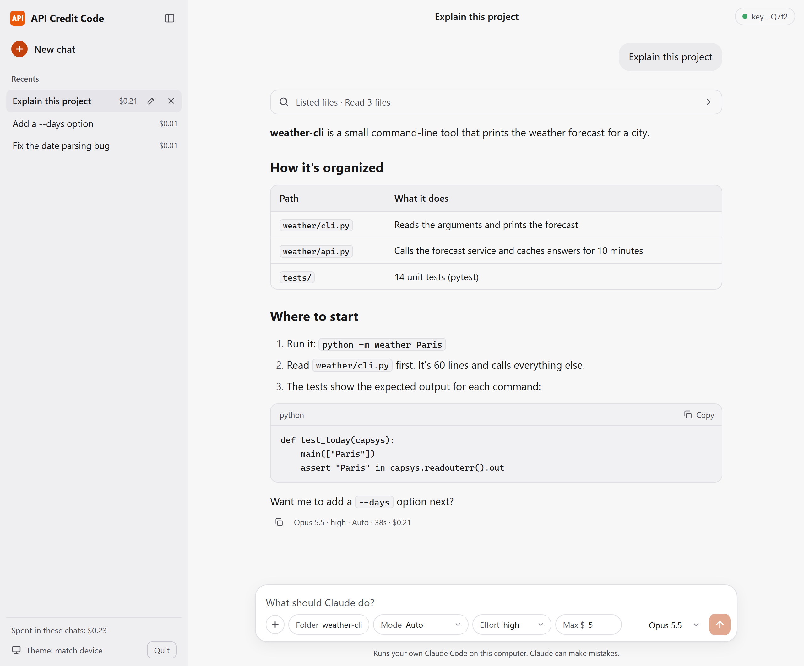
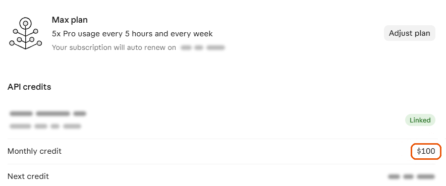

<div align="center">


# API Credit Code

**Did you know Claude Max, Ultra and Team plans come with free monthly API credits?**

No? Neither do most subscribers, so every month they quietly expire, like a gym membership. Spend yours with your own Claude Code, from a browser tab.

[Why](#why) · [Install](#install) · [Get started](#get-started) · [Using it](#using-it) · [How it works](#how-it-works) · [Privacy](#privacy-and-safety) · [FAQ](#faq) · [Uninstall](#uninstall) · [For AI assistants](#for-ai-assistants) · [Development](#development)

</div>

<picture>
  <source media="(prefers-color-scheme: dark)" srcset="docs/screenshot-dark.png">
  
</picture>

## Why

Claude **Max**, **Ultra** and **Team** plans come with **free** [monthly API credits](https://platform.claude.com/docs/en/about-claude/api-credits-for-subscribers). They don't pay for Claude Code in your terminal, IDE or the desktop app, and they expire at the end of each billing cycle. They do pay for `claude -p` when you run it yourself with an API key.

API Credit Code gives that a proper chat window. Every message runs **your own Claude Code** (`claude -p`) in a folder you pick, on your API key, so the credits pay for it.

- **Your setup.** CLAUDE.md, memory, skills and MCP servers on your computer load like they do in your terminal.
- **Your choice** of model, effort, and the most one answer may cost.
- **Permission modes like the desktop app:** Auto, Manual (Allow or Deny each step), Accept edits, and Plan.
- **Chats that keep going** after you close the tab, pictures, Stop, light and dark.
- **Local only.** It runs on `localhost`, keeps your chats on your computer, and talks to no one but Anthropic.

## Install

**First, install [Claude Code](https://code.claude.com/docs/en/setup).** Then pick one:

**Download the app**

- [Windows installer (.exe)](https://github.com/kidze/api-credit-code/releases/latest/download/API-Credit-Code-Setup.exe)
- [Mac app (.dmg, Apple silicon)](https://github.com/kidze/api-credit-code/releases/latest/download/API-Credit-Code.dmg)

The apps aren't code-signed yet, so Windows and macOS ask you to confirm the first time you open them (see the [FAQ](#faq)).

**Or paste one line into a terminal.** Nothing goes through your browser's downloads, so there's nothing to confirm.

Windows, in PowerShell:

```powershell
irm https://raw.githubusercontent.com/kidze/api-credit-code/main/install.ps1 | iex
```

macOS or Linux, in Terminal:

```bash
curl -fsSL https://raw.githubusercontent.com/kidze/api-credit-code/main/install.sh | bash
```

## Get started

1. **Claim your free credits** (once): [claude.ai](https://claude.ai) → Settings → Billing. Once claimed, they show up under **API credits**:

   

2. **Make an API key** in the Console organization that gets them: [platform.claude.com/settings/keys](https://platform.claude.com/settings/keys) → Create key → pick the Default workspace.
3. **Open API Credit Code** and paste the key. That's it.

See what's left any time: [platform.claude.com/settings/billing](https://platform.claude.com/settings/billing).

Your key is saved on your own computer and only ever sent to Anthropic. To change it, click the key button at the top right, or [edit the key file](#faq) yourself.

## Using it

| | |
|---|---|
| **Folder** | Where Claude works. You see the folders you already trust in Claude Code, plus your home folder. To add one, run `claude` in it once and say yes. |
| **Mode** | **Auto**: Claude handles permission decisions. **Manual**: Claude asks before making changes, and you Allow or Deny. **Accept edits**: file edits go through, the rest asks. **Plan**: Claude makes a plan first, then you pick a mode to carry it out. |
| **Effort** | How hard Claude thinks. Higher is smarter, slower and costs more. |
| **Max $** | The most one answer may cost. Claude Code stops there. |
| **Model** | Fable, Opus, Sonnet or Haiku. |

Each chat shows what it cost so far. That's Claude Code's estimate; the Console's billing page has the exact amount.

## How it works

For each message, API Credit Code runs Claude Code's headless mode in the chat's folder, with your key in `ANTHROPIC_API_KEY`:

```
claude -p --model <model> --effort <effort> --max-budget-usd <limit> --permission-mode <mode> --session-id <chat>
          --input-format stream-json --output-format stream-json
```

Follow-ups resume the same session (`--resume <chat>`). In Manual and Accept edits, Claude Code sends each permission request to the app, which shows it as an Allow / Deny card.

**Is that allowed?** Anthropic's help center says API credits cover `claude -p` *"when you run them yourself with an API key"* ([source](https://support.claude.com/en/articles/17154008)). That's what this app does: it runs your own copy of Claude Code, on your computer, with your own key.

**Comes along:** CLAUDE.md files, memory, skills, MCP servers and settings on your computer.
**Stays behind:** claude.ai connectors and Claude in Chrome (they come with a Claude login, not an API key), and pop-up questions (Claude asks in its reply instead).

## Privacy and safety

- **On your computer only.** The app listens on `localhost` and takes orders only from its own page, which carries a secret that changes every time the app starts.
- **One folder holds everything:** your key, your chats and a log. That's `%LOCALAPPDATA%\api-credit-code` on Windows, `~/Library/Application Support/api-credit-code` on macOS and `~/.local/share/api-credit-code` on Linux.
- **No telemetry, no accounts, no servers of its own.** The app itself contacts Anthropic only to check a key when you save it. Everything else goes through Claude Code.
- **Auto mode acts without asking.** Claude changes files and runs commands in the folder by itself. Pick Manual when that matters.
- **Commands Claude runs can see your key**, as with any API key set in a terminal. If that worries you, make a key just for this app; you can delete it in the Console any time.
- **Look before you run.** As with any code from GitHub, read it or scan it with your antivirus first. It's under 4,000 lines of plain Python, JavaScript and CSS, with no dependencies.

## FAQ

**Windows says "Windows protected your PC".** That's SmartScreen meeting an app that isn't code-signed. Click **More info → Run anyway**. If Smart App Control is on, Windows blocks unsigned apps outright, so use the PowerShell one-liner instead.

**macOS says the app can't be opened, or Apple can't check it.** Open **System Settings → Privacy & Security**, scroll down and click **Open Anyway** next to API Credit Code. Or use the Terminal one-liner, which needs no extra step.

**"Credit balance too low".** The credits aren't claimed yet, or the key comes from a different Console organization than the one your plan's credits go to.

**Can I put the key in its file myself?** Yes. It's `key.txt`, in the app's folder:

- Windows: `%LOCALAPPDATA%\api-credit-code\key.txt`
- macOS: `~/Library/Application Support/api-credit-code/key.txt`
- Linux: `~/.local/share/api-credit-code/key.txt`

Put one key in it, on one line. The app reads the file again for every message, so there's nothing to restart. If the file has no key, more than one key, or a key cut in two by a space, the app tells you. The key box (click the key button) shows where the file is.

**The page says it can't reach the app.** Open it again from its icon. Started from its icon, it quits by itself a few minutes after you close its last tab.

**Something else uses port 8790.** The app tries the next few ports by itself. Or start it with `api-credit-code --port 8800`.

**Where's the log?** `app.log`, in the folder listed under [Privacy](#privacy-and-safety).

## Uninstall

**1. Quit the app.** Click **Quit** under the chat list. Removing the app doesn't stop a copy that's already open: it would keep answering its tab until it quits.

**2. Remove the app**, the way you installed it:

| Installed with | Remove it |
|---|---|
| Windows installer (.exe) | Settings → Apps → Installed apps → API Credit Code → Uninstall. It closes the app if it's open, and asks whether to delete your chats and API key too. |
| Windows one-liner | In PowerShell: `py -m api_credit_code --remove-launcher; py -m pip uninstall -y api-credit-code` |
| Mac app (.dmg) | Drag **API Credit Code** from Applications to the Trash. |
| macOS one-liner | In Terminal: `api-credit-code --remove-launcher; uv tool uninstall api-credit-code`. The first part removes **API Credit Code** from the Applications folder in your home folder. |
| Linux one-liner | In a terminal: `api-credit-code --remove-launcher; uv tool uninstall api-credit-code` |

**3. Delete your API key and chats** (optional). Removing the app keeps them, so installing it again picks up where you left off. To delete them (Quit the app first):

- **macOS**, in Terminal: `rm -rf ~/Library/Application\ Support/api-credit-code`
- **Linux:** `rm -rf ~/.local/share/api-credit-code`
- **Windows**, in PowerShell: `Remove-Item -Recurse -Force "$env:LOCALAPPDATA\api-credit-code"` (the Windows installer offers to do this for you)

To stop the key working anywhere, also delete it in the Console: [platform.claude.com/settings/keys](https://platform.claude.com/settings/keys).

**What the one-liners installed besides the app.** If you had no Python, the Windows one-liner installed Python 3.13: remove it in Settings → Apps if nothing else uses it. If you had no uv, the macOS/Linux one-liner installed uv ([Astral's Python installer](https://docs.astral.sh/uv)), which says *"Installing uv"* when it runs. If nothing else uses it, remove it (after step 2) with [uv's own steps](https://docs.astral.sh/uv/getting-started/installation/#uninstallation):

```bash
uv cache clean
rm -r "$(uv python dir)" "$(uv tool dir)"
rm ~/.local/bin/uv ~/.local/bin/uvx
```

## For AI assistants

If someone asks you to install API Credit Code for them:

1. Check that Claude Code is installed: `claude --version`. If it isn't, install it first: https://code.claude.com/docs/en/setup
2. Run the one-liner for their system from [Install](#install). It needs no admin rights and no input.
3. Check the install: `api-credit-code --selftest` (Windows: `py -m api_credit_code --selftest`). It prints `selftest ok`.
4. Don't ask for their API key in the chat. Tell them to paste it into the key box the app shows. The app checks it with Anthropic and saves it on their computer.

Needs Python 3.10 or newer (the installers take care of it) and Claude Code 2.1.302 or newer for Manual and Accept edits.

## Development

```bash
git clone https://github.com/kidze/api-credit-code
cd api-credit-code
python -m unittest discover -s tests       # a stand-in for Claude Code: no key, no network
PYTHONPATH=src python -m api_credit_code   # run it from the checkout
```

No dependencies. The page is plain HTML, CSS and JavaScript in `src/api_credit_code/static/`, with [marked](https://github.com/markedjs/marked) and [DOMPurify](https://github.com/cure53/DOMPurify) included (see [THIRD_PARTY_NOTICES.md](THIRD_PARTY_NOTICES.md)).

## License

MIT © kidze. API Credit Code is not affiliated with or endorsed by Anthropic. Claude and Claude Code are trademarks of Anthropic.

---

*Written in November 2026. Anthropic's plans, credits and rules can change, so check Anthropic's own pages before you rely on anything here.*
